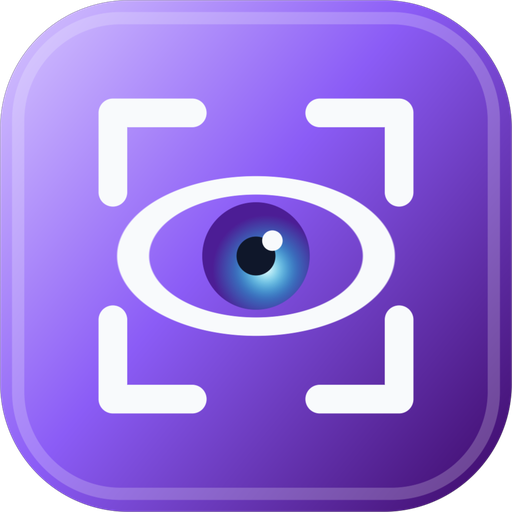
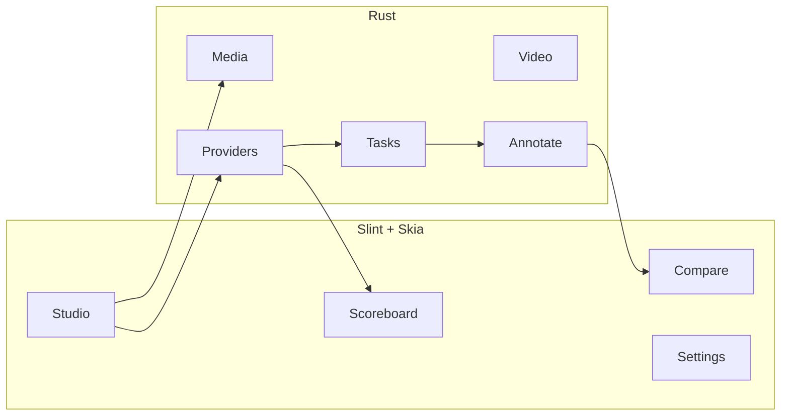

<p align="center">
  
</p>

<h1 align="center">VisionLab</h1>

<p align="center">
  <strong>LLM Vision Benchmark Studio</strong><br>
  A native Windows app for probing what vision models can actually see.
</p>

<p align="center">
  
  
  
  
</p>

<p align="center">
  Open an image or a video frame. Send it to a vision model.
  Draw the boxes, masks, points, and text it returns.
  Grade the run Pass or Fail. Keep a scoreboard.
</p>

---

## Why it exists

Cloud and local vision models look great in a chat window. They fall apart on a real photo: boxes in the wrong space, masks that miss the object, OCR that invents a price.

VisionLab is a studio for that gap. You pick the task, you pick the model, you see the overlay on the pixels, and you record a human verdict with latency and cost.

## What you can test

| Task | What gets drawn |
| --- | --- |
| Classification | Labels on the canvas |
| Object detection | Bounding boxes |
| Instance segmentation | Polygon masks |
| Keypoint detection | Landmarks |
| OCR | Text regions |

Load a still, or open a video, seek to a frame, and run from there. Zoom toward the cursor. Compare original vs annotated side by side.

## Providers

| Provider | Notes |
| --- | --- |
| **OpenAI** | Chat Completions, vision models |
| **Anthropic** | Messages API |
| **OpenRouter** | Live catalog and prices |
| **Ollama** | Local. No API key. `http://localhost:11434` |
| **Custom** | Any OpenAI-compatible `/v1` endpoint |

Keys never land in `config.json`. They go to **Windows Credential Manager** as `VisionLab/<provider-id>`. Ollama stays local: start `ollama serve`, pull a vision model (`llama3.2-vision`, `qwen2.5vl`, …), then Test connection and refresh the catalog.

## Install

### Windows installer

Build a Setup executable (Inno Setup 6):

```powershell
.\tools\package.ps1
```

That writes:

```
dist\VisionLab-Setup-0.1.0.exe
```

Run it. Per-user install is the default (no admin). A Start Menu shortcut is created; a desktop shortcut is optional.

### From source

Needs a recent stable Rust (MSVC toolchain) on Windows 10/11.

```powershell
$env:SLINT_BACKEND = "winit-skia"
cargo run --release
```

Video uses **ffmpeg** plus **ffprobe**. A system install (for example Gyan via WinGet) is used when present. Otherwise VisionLab can download a local copy next to the executable.

## First run

1. Open **Settings → Providers**.
2. Save a cloud key, or select **Ollama** and test the local server.
3. Refresh the model catalog and click **Use** on a vision model.
4. In **Studio**, open an image (or a video frame).
5. Pick a task. **Run**.
6. Grade **Pass** or **Fail**. Notes stick with the verdict.

The connect banner stays up until a cloud key is saved, or an Ollama model is chosen.

## Studio, Compare, Scoreboard

```
Studio     annotated canvas + results JSON, latency, tokens, cost
Compare    original vs overlay, independent zoom
Scoreboard pass rate, latency, spend, CSV / JSON export
```

Huge segmentation dumps are clipped in the Results pane so scrolling stays usable. **Copy** still puts the full JSON on the clipboard.

Config, logs, and the scoreboard live in `%APPDATA%\VisionLab`. Uninstall does not wipe that folder or your keys.

## Shortcuts

| Keys | Action |
| --- | --- |
| `Ctrl+O` | Open image |
| `Ctrl+Shift+O` | Open video |
| `Ctrl+Enter` | Run test |
| `Ctrl+1` … `Ctrl+5` | Task chips |
| `Ctrl+,` | Settings |
| `Space` | Play / pause video |

## Architecture



- UI thread owns the window. Provider HTTP runs on Tokio.
- Video preview is an ffmpeg worker that pushes RGBA frames.
- Overlays are composited onto the original pixels, not guessed in UI space.

## Package layout

```
src/           app, providers, tasks, annotate, video, settings
ui/            Slint screens, theme, widgets
assets/        icon, marks
tools/         package.ps1, Inno Setup script
```

## Privacy

- API keys: Credential Manager only, never the installer, never logs.
- Images leave the machine only when you run a cloud model.
- Ollama keeps inference on this PC.

## Attribution

UI built with [Slint](https://slint.dev/), used under the Slint royalty-free desktop license with attribution.

## License

Application source: see the repository. Slint itself is licensed separately ([Slint license](https://github.com/slint-ui/slint/blob/master/LICENSE.md)).
